# TAREA SRI UT1 - Héctor Morán

## 1. Esquema de la arquitectura
Para el despliegue de la infraestructura en AWS Learner Lab (región `us-east-1`), he creado la siguiente red:
- **VPC (`vpc-hector`):** Bloque CIDR `10.11.0.0/16`
- **Subred pública (`subnet-pub-hector`):** Bloque `10.11.1.0/24` con asignación automática de IP pública.
- **Puerta de enlace de Internet (`igw-hector`) y tabla de rutas (`rt-pub-hector`):** Conectividad hacia el exterior asociada a la subred pública.
- **Grupo de seguridad (`sg-web-hector`):** Acceso SSH (puerto 22) restringido solo a mi IP de trabajo y puertos HTTP (80 y 8080) abiertos a cualquier origen.
- **Instancia EC2 (`web-hector`):** Tipo `t3.medium` con Ubuntu Server y configurada con la zona horaria de Madrid.

---

## 2. Procedimiento por apartado

### Apartado 1: Red e Instancia en AWS
- **Qué he hecho:** He creado la VPC, subred, IGW, tabla de rutas, grupo de seguridad e instancia EC2 con zona horaria de Madrid.

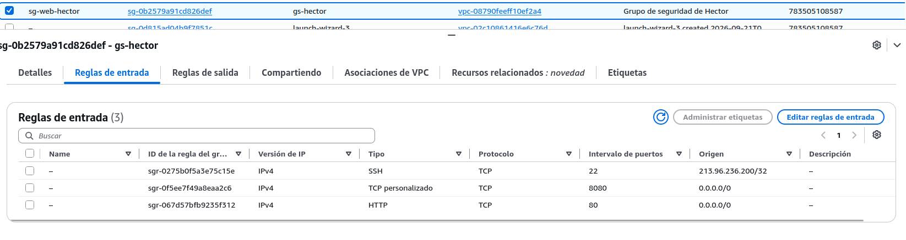

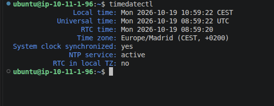

- **Cómo lo he comprobado:** He verificado que responda directamente a través de la IP pública desde el navegador.

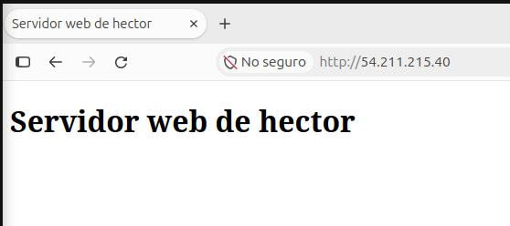

### Apartado 2: Instalación y configuración básica de Nginx
- **Qué he hecho:** He instalado Nginx, creado el sitio por defecto con carpeta propia, habilitado la ruta `/estado` y ocultado la versión del servidor (`server_tokens off;`) para asegurar el servicio y proteger la información del software.
- **Cómo lo he comprobado:** He realizado una verificación visual del sitio por defecto y comprobado las cabeceras de respuesta con el comando `curl -I`.

### Apartado 3: Sitios virtuales
- **Qué he hecho:** He configurado las tres webs (`www.hector.test`, que responde también a `hector.test`; `blog.hector.test`; y la Intranet en el puerto 8080) junto con el sitio por defecto para alojar múltiples servicios independientes en la misma máquina virtual.
- **Cómo lo he comprobado:** He verificado los enlaces simbólicos activados en `sites-enabled` y realizado peticiones HTTP a cada virtual host.

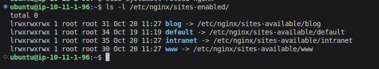
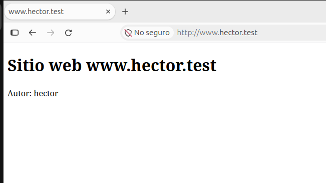
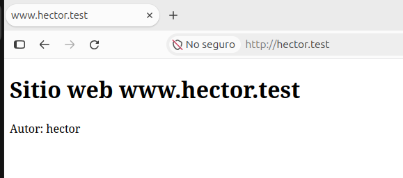
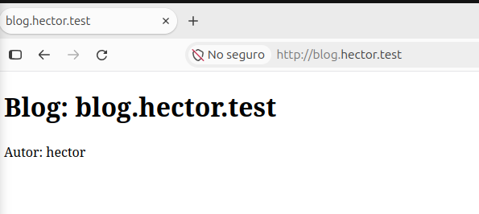

### Apartado 4: Módulos
- **Qué he hecho:** He instalado el módulo `fancyindex` para listar ficheros en `/descargas/` con formatos legibles y hora local, restringido carpetas sin índice (403), y configurado `hora.php` mediante PHP-FPM.
- **Cómo lo he comprobado:** He comprobado el listado en `/descargas/`, la ejecución correcta de la hora en Madrid con `hora.php` y el bloqueo 403 en carpetas sin índice.

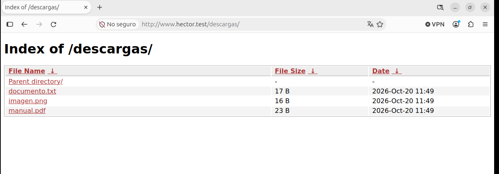
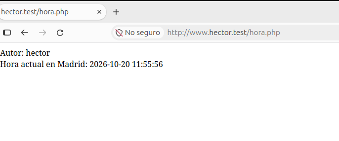
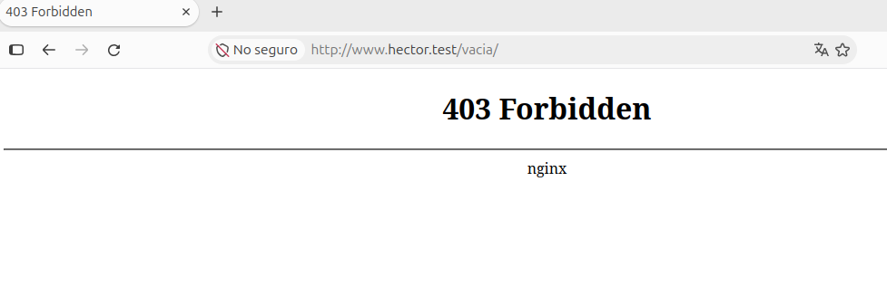

### Apartado 5: Autenticación y control de acceso
- **Qué he hecho:** He activado la protección de la Intranet (puerto 8080) mediante credenciales para los usuarios `hector` y `profesor`, y una configuración mixta en `/admin/` (libre desde la IP de trabajo y el servidor, restringida con contraseña de `hector` desde el exterior).
- **Cómo lo he comprobado:** He comprobado que salta el cuadro de diálogo de solicitud de credenciales y que se concede el acceso a la Intranet tras autenticarse correctamente.

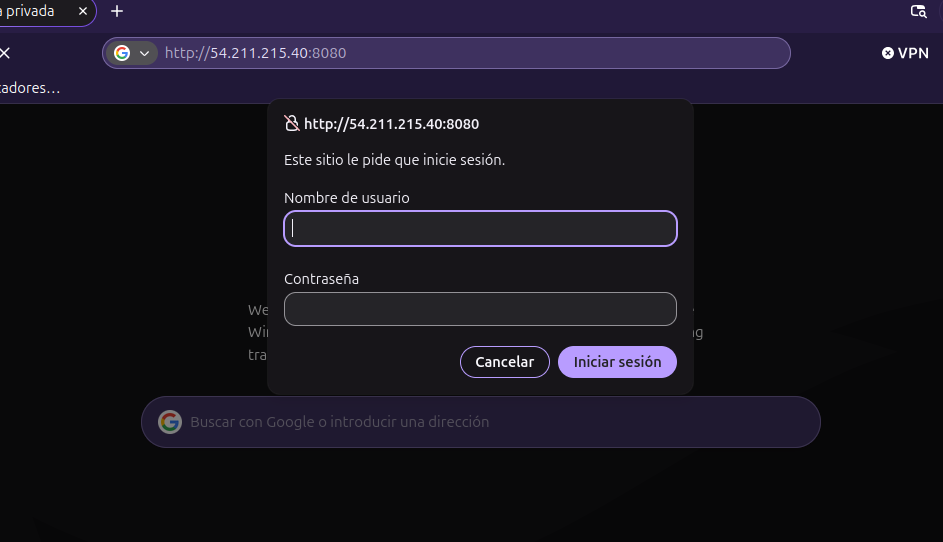
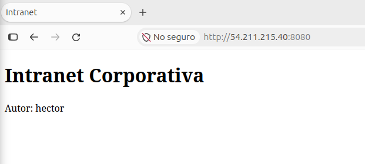

### Apartado 6: Registros, estadísticas e incidencias
- **Qué he hecho:** He configurado los registros independientes de accesos y errores para cada sitio, generado tráfico simulado, extraído las estadísticas con `wc -l`, creado el informe HTML con GoAccess y documentado las incidencias.
- **Cómo lo he comprobado:** He consultado los datos analíticos guardados en `evidencias/estadisticas.md` y revisado el informe HTML generado en `informes/informe.html`.

---

## 3. Incidencias y resolución

### Incidencia 1: Error 403 Forbidden al acceder a directorios sin índice
  Al intentar acceder a `http://www.hector.test/vacia/`, el navegador devolvía un código de error `403 Forbidden`.  

`[error] 1234#1234: *1 directory index of "/var/www/www/vacia/" is forbidden, client: 54.211.215.40...`

- **Causa:** Nginx tiene deshabilitado el listado de directorios automático (`autoindex off`) por seguridad y la carpeta no tenía ningún fichero `index.html` ni `index.php`.  
Para arreglarlo verifiqué que esto era lo esperado según los requisitos de seguridad de la práctica para evitar el listado no autorizado de archivos.

### Incidencia 2: Fallo de sintaxis al recargar Nginx
Al ejecutar `sudo systemctl reload nginx`, el servicio no aplicaba los cambios o devolvía un error en la terminal.  

`[emerg] 4567#4567: unknown directive "rooot" in /etc/nginx/sites-enabled/www:6`.

- **Causa:** Tenía un error tipográfico al escribir la directiva de la ruta raíz (`rooot` en vez de `root`) en el fichero de configuración.  
Para arreglarlo corregí el error tipográfico en el fichero, validé la sintaxis con `sudo nginx -t` y recargué el servicio sin fallos.

---

## 4. Recomendaciones de uso
- **Acceso a los sitios web:** Para navegar por `www.hector.test`, `hector.test` o `blog.hector.test`, hay que asegurarse de tener la IP pública de la instancia de AWS configurada en el archivo `/etc/hosts` de la máquina local.
- **Intranet e informes:** Se accede mediante el puerto `8080` (por ejemplo: `http://<IP-PUBLICA>:8080`). Hay que iniciar sesión con los usuarios `hector` o `profesor`. El informe de GoAccess se puede consultar en `http://<IP-PUBLICA>:8080/informe.html`.
- **Zona de Administración:** La ruta `/admin/` está protegida para accesos desde fuera de la red local y requiere autenticación exclusiva con el usuario `hector`.

---

## 5. Declaración de uso de Inteligencia Artificial
He usado IA generativa como herramienta de apoyo, para resolver dudas técnicas y consultar algunos comandos que no sabía. Aún así, he contrastado las respuestas y las he probado y validado directamente en AWS.