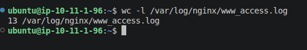

# Estadísticas del servidor web de hector

## 1. Número total de peticiones
Para obtener el número total de peticiones registradas en el servidor web, ejecuté el comando `wc -l /var/log/nginx/www_access.log`, y el resultado fue un total de `13 /var/log/nginx/www_access.log.`

## 2. Resumen de tráfico y GoAccess

Para generar el informe analítico de tráfico de la intranet en formato HTML, utilizé la orden `sudo goaccess /var/log/nginx/www_access.log -o /var/www/intranet/informe.html --log-format=COMBINED`. El resultado de las estadísticas se puede ver directamente en el informe HTML guardado en la carpeta de informes.